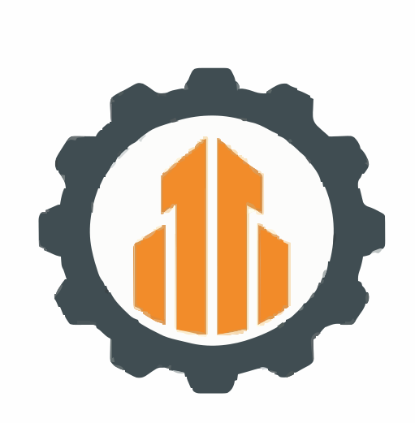
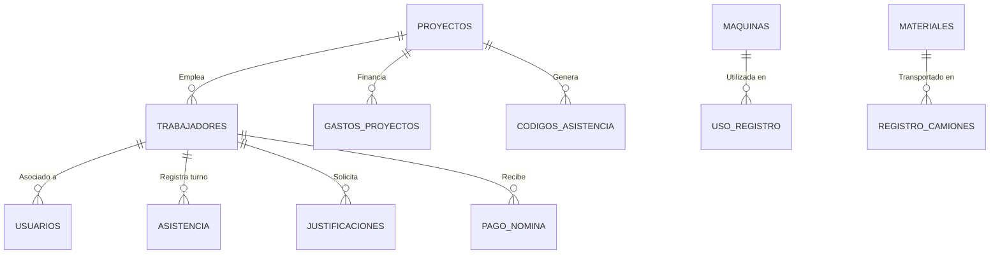

  
  <h1>🏗️ VyGApps</h1>
  
<b>Sistema Integral de Gestión de Obras, Presupuestos y Logística</b>

  <!-- Badges -->
  
  
  
  
  

 

VyGApps es una plataforma desarrollada a medida en **Java EE (Jakarta EE)** diseñada para centralizar, monitorear y optimizar los recursos en proyectos de construcción. Proporciona herramientas avanzadas de control de asistencia, nóminas, gastos de obra, uso de maquinaria y logística de camiones de materiales.

---

## ✨ Características Destacadas

*   ⏱️ **Control de Asistencia Biométrico-Digital:** Generación de códigos temporales de sesión para fichaje de empleados, con tolerancia de 15 minutos, cálculo automático de llegadas tardías y marcas anómalas.
*   💰 **Finanzas y Nóminas:** Automatización de planillas de pago, cálculos de horas extras, inyección de presupuestos en tiempo real y generación de recibos en formato PDF.
*   🚜 **Logística y Control de Activos:** Registro de uso de maquinaria, control estricto de camiones (materiales) y autorizaciones jerárquicas.
*   👥 **Múltiples Roles:** Sistema de permisos robusto con vistas especializadas para Administradores, Supervisores de Obra y Técnicos Operativos.
*   🎨 **UI/UX Moderna:** Interfaz *Responsive* con iconos vectoriales SVG, notificaciones *Toast* y menús dinámicos.

---

## 📸 Vistas de la Aplicación

> **Nota:** Puedes reemplazar las rutas de abajo subiendo capturas reales de tu aplicación a la carpeta `src/main/webapp/images/screenshots/`

  
  

---

## 📐 Arquitectura de Base de Datos

La aplicación está respaldada por una estructura relacional robusta en MySQL, capaz de manejar la escalabilidad de diferentes proyectos simultáneos:

---

## ⚙️ Despliegue y Configuración Local

Sigue estos pasos estrictamente para ejecutar el sistema en tu entorno local.

### 1. Preparar la Base de Datos
El proyecto incluye un script oficial de la base de datos ubicado en la carpeta `SQL/`.
1. Abre tu gestor de base de datos (ej. phpMyAdmin, DBeaver, MySQL Workbench).
2. Ejecuta el script completo que se encuentra en: 
   👉 `src/main/java/SQL/vygappsJunio.sql`
3. Esto generará la base de datos `vygapps` con sus 16 tablas y los procedimientos almacenados correspondientes.
4. Si tu usuario y contraseña de MySQL no son los que están por defecto (`root` / sin clave), debes actualizarlos en el archivo de conexión `src/main/java/Conexion/ConectarBD.java`.

### 2. Levantar el Servidor
1. Asegúrate de tener instalado **JDK 21.0.4** y **Apache Tomcat 9**.
2. Abre el proyecto con Apache NetBeans.
3. Haz un `Clean and Build` para que Maven descargue el driver JDBC de MySQL y las librerías Jakarta EE.
4. Da clic derecho en el proyecto y selecciona `Run`.
5. Accede desde tu navegador a: `http://localhost:8080/VyGapps/login.jsp`

---

## 🛡️ Seguridad
Este sistema incluye medidas de seguridad activas:
*   **AuthFilter Global:** Bloqueo de URLs directas; impide el acceso a *Servlets* y *JSPs* sin una sesión autenticada activa.
*   **Gestión de Recursos (Connection Management):** Uso intensivo del patrón `try-with-resources` en todos los DAOs para prevenir fugas de memoria (Zombie Connections) en el servidor de base de datos.
*   **Sanitización de Datos:** Prevención de vulnerabilidades por Inyección SQL.

---

## 📄 Licencia

Este es un proyecto de **Código Cerrado y Propietario**. Está estrictamente prohibida la copia, distribución, modificación o uso comercial no autorizado del código fuente sin el consentimiento explícito de los desarrolladores originales.

 

  Desarrollado y mantenido por <b>Benja</b>. Todos los derechos reservados © 2026

